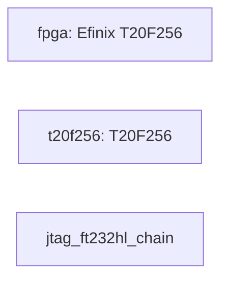

# T20F256 XD-PS Evaluation Board board manual

Revision `1` · material `1.0.0` · composition `standalone`.

This combined manual presents the resolved product while preserving module and carrier facts as separate machine-owned layers.

## Architecture

## Development targets

| Target | Type | Adapter | Exact device | State |
| --- | --- | --- | --- | --- |
| fpga | fpga | efinity | Efinix T20F256 | CONFIRMED |

## Pin coverage

| Target | Coverage | Evidence |
| --- | --- | --- |
| fpga | FUNCTIONAL_PINOUT_ONLY | pinout/t20f256-xd-ps-eval-v1.csv |

## Hardware

Facts below are rendered once from the resolved module/carrier layers. Intermediate board-to-board connector positions are intentionally excluded.

| ID | Category/Purpose | Manufacturer | Part | State | Sources |
| --- | --- | --- | --- | --- | --- |
| t20f256 | — | — | T20F256 | CONFIRMED | t20f256-efinity-pinout, t20f256-xd-ps-eval-schematic |
| jtag_ft232hl_chain | — | — | — | CONFIRMED | t20f256-xd-ps-eval-schematic |
| buzzer | — | — | — | CONFIRMED | t20f256-xd-ps-eval-schematic |
| dip_switches | — | — | — | CONFIRMED | t20f256-xd-ps-eval-schematic |
| i2c_eeprom_at24c01c | — | — | — | CONFIRMED | t20f256-xd-ps-eval-schematic |
| jtag_ft232hl | — | — | — | CONFIRMED | t20f256-xd-ps-eval-schematic |
| lvds_exp_cn1 | — | — | — | CONFIRMED | t20f256-xd-ps-eval-schematic |
| seg_digit_display | — | — | — | CONFIRMED | t20f256-xd-ps-eval-schematic |
| spi_flash_w25q32 | — | — | — | CONFIRMED | t20f256-xd-ps-eval-schematic |
| uart_ch340n | — | — | — | CONFIRMED | t20f256-xd-ps-eval-schematic |
| user_buttons | — | — | — | CONFIRMED | t20f256-xd-ps-eval-schematic |
| user_leds | — | — | — | CONFIRMED | t20f256-xd-ps-eval-schematic |
| vga_resistor_dac | — | — | — | CONFIRMED | t20f256-xd-ps-eval-schematic |

## Board interfaces

| ID | Protocol | Direction | Endpoints | State | Sources |
| --- | --- | --- | --- | --- | --- |

## Final cross-chip interface contract

| ID | Protocol | Direction | Final endpoints | Clock | Reset | State |
| --- | --- | --- | --- | --- | --- | --- |

## Power

| ID | Voltage | Consumers | State | Sources |
| --- | --- | --- | --- | --- |

## Clocks

| ID | Frequency | Consumers | State | Sources |
| --- | --- | --- | --- | --- |
| clk_50m_osc | 50000000 | — | CONFIRMED | t20f256-xd-ps-eval-schematic |
| clk_50m_aux | 50000000 | — | CONFIRMED | t20f256-xd-ps-eval-schematic |

## Bring-up and development

### Bring-up

1. Review every `UNVERIFIED` or `CONFLICT` item before power-up.
2. Confirm rails, clock frequency, reset polarity, boot mode, and debug path from controlled sources.
3. Run the FPGA native unified compile; record compile evidence separately from programming and hardware evidence.
4. Bind the RK3588 profile to a real pinned BSP before any build claim.
5. Program, boot, and board-test only with their own evidence receipts.

### Development guide

| Target | Type | Adapter | Exact device | State |
| --- | --- | --- | --- | --- |
| fpga | fpga | efinity | Efinix T20F256 | CONFIRMED |

- FPGA Stage0 is generated from confirmed `main_clock`, `reset`, and `user_led` facts. A generated project is not a native-build PASS.
- RK3588 remains `PROFILE_READY` until a real source root, pinned BSP commit, build environment, loader, partition layout, and artifacts are explicitly bound.
- Use the System project when both targets and their interface contract must be developed together.

## Uncertainty and conflicts

No unresolved or conflicting facts are declared.

## Evidence sources

| ID | Type | Owner | Location | Observed | State |
| --- | --- | --- | --- | --- | --- |
| t20f256-efinity-pinout | tool_output | efinix | devices/T20F256.pinout.csv | 2026-09-22 | CONFIRMED |
| t20f256-xd-ps-eval-schematic | board_document | ws-e2-hardware | boards/t20f256-xd-ps-eval/t20f256-xd-ps-eval.md | 2026-09-22 | CONFIRMED |

Distributor and community pages are discovery-only and cannot confirm electrical or functional facts.
