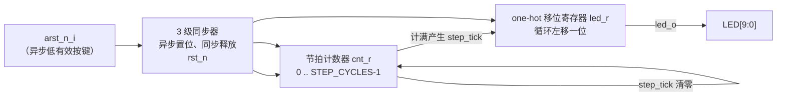

English | [中文](marquee.md)

# Marquee — 10-LED Running-Light

`marquee` is the entry-level design deliverable for the [t20f256-xd-ps-eval](../../t20f256-xd-ps-eval.md) standalone evaluation board: a parameterized one-hot running-light core driving the board's 10 user LEDs, demonstrating the standard jacket delivery form (RTL + self-checking simulation + authoritative constraints + Efinity project snapshot). The project file's description field is tagged `hardware-validated` — it has been validated on hardware.

## Hardware Resource Usage

| Signal | Direction | Pin | Bank | Level | On-board resource |
|---|---|---|---|---|---|
| `clk_50m_i` | in | H13 | 3D_3E | 3.3 V LVTTL/LVCMOS | 50 MHz system clock (GCLK) |
| `arst_n_i` | in | A4 | 1D_1E | 3.3 V LVTTL/LVCMOS | active-low reset button BUT1 |
| `led_o[0]` | out | T8 | 4B | 3.3 V LVTTL/LVCMOS | user LED 0 |
| `led_o[1]`–`led_o[9]` | out | T9/T10/T11/T12/R13/T14/R14/T15/R15 | 4A | 3.3 V LVTTL/LVCMOS | user LEDs 1–9 |

All involved banks (1A, 1B_1C, 1D_1E, 3A_3B_3C, 3D_3E, 4A, 4B) are at 3.3 V.

## Directory Layout

```text
marquee/
├── rtl/
│   ├── led_marquee.sv          # parameterized running-light core (reusable)
│   └── top.v                   # top level t20f256_xd_ps_eval_marquee
├── sim/
│   └── tb_led_marquee.v        # self-checking testbench (four properties)
├── constraints/
│   ├── t20f256_xd_ps_eval_marquee.pins.isf   # pin locations and IO levels (authoritative)
│   └── t20f256_xd_ps_eval_marquee.sdc        # timing constraints (authoritative)
└── t20f256-xd-ps-eval-marquee.xml    # Efinity 2026.1 project snapshot
```

## How It Works

The design is single-clock-domain synchronous logic with three stages: reset synchronizer release → step beat generation → one-hot circular shift.



Key points of the core module `led_marquee`:

- **Reset strategy**: `rst_n_i` asserts asynchronously and is released synchronously inside the clock domain through a 3-stage synchronizer, avoiding metastability at reset release; all internal logic uses the synchronized-release `rst_n`.
- **Step beat**: the `STEP_CYCLES` counter uses clock-enable semantics (generating a single-cycle `step_tick` on overflow), producing no derived clock, keeping timing analysis simple.
- **Shift style**: a one-hot register rotating left (`{led_r[LEDS-2:0], led_r[LEDS-1]}`), reset value `10...0`, advancing one position per `step_tick`.
- **Parameterization**: `LEDS` (default 10) and `STEP_CYCLES` (default 6_250_000, i.e. an 8 Hz step at 50 MHz and a full revolution of about 1.25 s) can both be tuned per target platform.

The top level `t20f256_xd_ps_eval_marquee` only wires ports, instantiating `led_marquee` with default parameters.

### Timing Constraints

`constraints/t20f256_xd_ps_eval_marquee.sdc` declares only the main clock:

```tcl
create_clock -name clk_50m -period 20.000 [get_ports clk_50m_i]
```

Single-domain design with no cross-clock paths; all outputs drive on-board LEDs, requiring no IO timing exceptions.

## Simulation Verification

`sim/tb_led_marquee.v` is a self-checking testbench that speeds things up with `STEP_CYCLES = 4`, sampling continuously over a 30 × STEP_CYCLES window and checking four properties:

| Property | Assertion |
|---|---|
| PROP-RESET | the first sampled value after reset release = `10...0` (bit0 lit) |
| PROP-ONEHOT | at any sampled time exactly 1 bit is 1 |
| PROP-ROTATE | adjacent steps satisfy the rotate-left relation |
| PROP-HOLD | exactly STEP_CYCLES cycles elapse between two transitions |

On full pass it prints `TB-RESULT: PASS`; otherwise it stops immediately and reports the failing property.

## Build and Programming

1. Open `t20f256-xd-ps-eval-marquee.xml` with Efinity 2026.1 (top `t20f256_xd_ps_eval_marquee`, seed=1, Debugger auto_instantiation off).
2. Run Synthesis → Place & Route → Generate Bitstream in order; the authoritative sources are `.pins.isf` and `.sdc` under `constraints/`, while `.peri.xml` and the like are generated artifacts.
3. Program the bitstream onto the t20f256-xd-ps-eval board via the programmer; after power-on, observe the one-hot running-light across the 10 LEDs; pressing BUT1 resets and restarts from LED0.

## Integration Notes

- `led_marquee` is a purely synchronous, board-independent core module; the whole directory can be reused on other boards — only the top level and constraints need rewriting for the target board.
- When changing platforms, adjust `STEP_CYCLES` accordingly: target step frequency f_step and main clock f_clk satisfy `STEP_CYCLES = f_clk / f_step`.
- To change pins, modify the board pin map and regenerate the ISF via the SDK; do not hand-edit generated constraint files.
