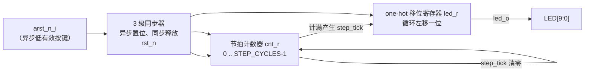

[English](marquee.en.md) | 中文

# Marquee — 10 位 LED 跑马灯

`marquee` 是 [t20f256-xd-ps-eval](../../t20f256-xd-ps-eval.md) 独立评估板上的入门级设计交付物：以参数化的 one-hot 跑马灯核心驱动板上 10 个用户 LED，用于演示 jacket 的标准交付形态（RTL + 自检仿真 + 权威约束 + Efinity 工程快照）。工程文件描述字段标记 `hardware-validated`，已在硬件上完成验证。

## 硬件资源占用

| 信号 | 方向 | 管脚 | Bank | 电平 | 板上资源 |
|---|---|---|---|---|---|
| `clk_50m_i` | in | H13 | 3D_3E | 3.3 V LVTTL/LVCMOS | 50 MHz 系统时钟（GCLK） |
| `arst_n_i` | in | A4 | 1D_1E | 3.3 V LVTTL/LVCMOS | 低有效复位按键 BUT1 |
| `led_o[0]` | out | T8 | 4B | 3.3 V LVTTL/LVCMOS | 用户 LED 0 |
| `led_o[1]`–`led_o[9]` | out | T9/T10/T11/T12/R13/T14/R14/T15/R15 | 4A | 3.3 V LVTTL/LVCMOS | 用户 LED 1–9 |

全部涉及 bank（1A、1B_1C、1D_1E、3A_3B_3C、3D_3E、4A、4B）电压均为 3.3 V。

## 目录结构

```text
marquee/
├── rtl/
│   ├── led_marquee.sv          # 参数化跑马灯核心（可复用）
│   └── top.v                   # 顶层 t20f256_xd_ps_eval_marquee
├── sim/
│   └── tb_led_marquee.v        # 自检 testbench（四性质）
├── constraints/
│   ├── t20f256_xd_ps_eval_marquee.pins.isf   # 管脚位置与 IO 电平（权威）
│   └── t20f256_xd_ps_eval_marquee.sdc        # 时序约束（权威）
└── t20f256-xd-ps-eval-marquee.xml    # Efinity 2026.1 工程快照
```

## 工作原理

设计为单时钟域同步逻辑，由三级组成：复位同步释放 → 步进节拍发生 → one-hot 循环移位。



核心模块 `led_marquee` 的要点：

- **复位策略**：`rst_n_i` 异步置位、经 3 级同步器在时钟域内同步释放，避免复位释放时的亚稳态；内部逻辑全部使用同步释放后的 `rst_n`。
- **步进节拍**：`STEP_CYCLES` 计数采用 clock enable 语义（计满产生单周期 `step_tick`），不生成派生时钟，时序分析简单。
- **移位方式**：one-hot 寄存器循环左移（`{led_r[LEDS-2:0], led_r[LEDS-1]}`），复位值 `10...0`，每个 `step_tick` 移动一位。
- **参数化**：`LEDS`（默认 10）与 `STEP_CYCLES`（默认 6_250_000，即 50 MHz 下步进 8 Hz、整圈约 1.25 s）均可按目标平台调整。

顶层 `t20f256_xd_ps_eval_marquee` 仅做端口直连，以默认参数实例化 `led_marquee`。

### 时序约束

`constraints/t20f256_xd_ps_eval_marquee.sdc` 仅声明主时钟：

```tcl
create_clock -name clk_50m -period 20.000 [get_ports clk_50m_i]
```

单域设计无跨时钟路径；所有输出为片上 LED 驱动，无 IO 时序例外需求。

## 仿真验证

`sim/tb_led_marquee.v` 为自检 testbench，取 `STEP_CYCLES = 4` 提速，在 30 × STEP_CYCLES 窗口内持续采样，校验四条性质：

| 性质 | 断言内容 |
|---|---|
| PROP-RESET | 复位释放后首个采样值 = `10...0`（bit0 亮） |
| PROP-ONEHOT | 任一采样时刻恰有且仅有 1 位为 1 |
| PROP-ROTATE | 相邻步进满足循环左移关系 |
| PROP-HOLD | 两次翻转之间恰好间隔 STEP_CYCLES 个周期 |

全部通过时输出 `TB-RESULT: PASS`，否则立即终止并报告失败性质。

## 编译与烧录

1. 使用 Efinity 2026.1 打开 `t20f256-xd-ps-eval-marquee.xml`（顶层 `t20f256_xd_ps_eval_marquee`，seed=1，Debugger auto_instantiation 关闭）。
2. 依次执行 Synthesis → Place & Route → Generate Bitstream；权威源为 `constraints/` 下的 `.pins.isf` 与 `.sdc`，`.peri.xml` 等为生成物。
3. 通过编程器将比特流写入 t20f256-xd-ps-eval 板卡，上电后观察到 10 个 LED 的 one-hot 跑马灯效果；按 BUT1 复位后从 LED0 重新开始。

## 集成要点

- `led_marquee` 为纯同步、无板级依赖的核心模块，可整目录复用到其他板卡：只需按目标板重写顶层与约束。
- 更换平台时同步调整 `STEP_CYCLES`：目标步进频率 f_step 与主频 f_clk 满足 `STEP_CYCLES = f_clk / f_step`。
- 管脚如需变更，请修改板卡 pin map 后经 SDK 重新生成 ISF，不要手工编辑生成的约束文件。
