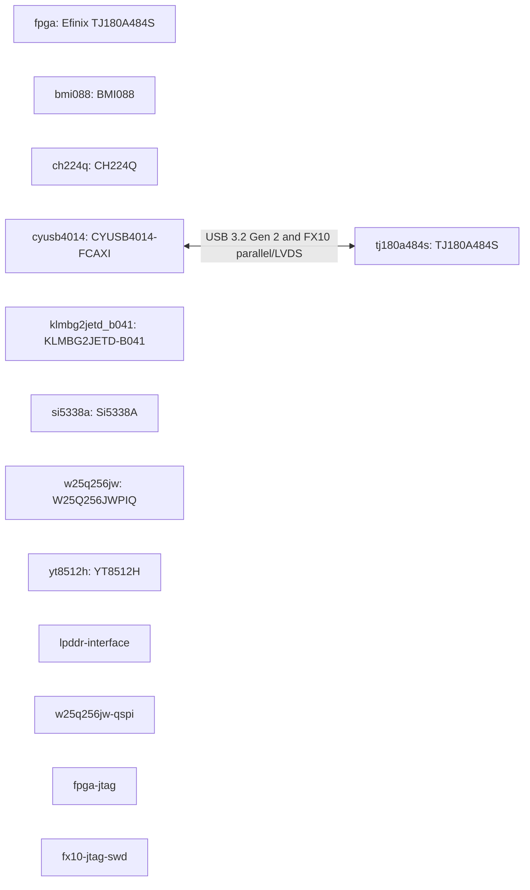

# WS-E1 Titanium TJ180A484S Core Module board manual

Revision `1` · material `1.0.0` · composition `module_carrier`.

This combined manual presents the resolved product while preserving module and carrier facts as separate machine-owned layers.

## Architecture

## Development targets

| Target | Type | Adapter | Exact device | State |
| --- | --- | --- | --- | --- |
| fpga | fpga | efinity | Efinix TJ180A484S | CONFIRMED |

## Pin coverage

| Target | Coverage | Evidence |
| --- | --- | --- |
| fpga | FUNCTIONAL_PINOUT_ONLY | pinout/ws-e1-fpga-v1.csv |

## Hardware

Facts below are rendered once from the resolved module/carrier layers. Intermediate board-to-board connector positions are intentionally excluded.

| ID | Category/Purpose | Manufacturer | Part | State | Sources |
| --- | --- | --- | --- | --- | --- |
| bmi088 | — | — | BMI088 | CONFIRMED | ws-e1-base-schematic |
| ch224q | — | — | CH224Q | CONFIRMED | ws-e1-base-schematic |
| cyusb4014 | — | Infineon | CYUSB4014-FCAXI | CONFIRMED | ws-e1-module-schematic |
| klmbg2jetd_b041 | — | — | KLMBG2JETD-B041 | CONFIRMED | ws-e1-base-schematic |
| si5338a | — | — | Si5338A | CONFIRMED | ws-e1-base-schematic |
| tj180a484s | — | Efinix | TJ180A484S | CONFIRMED | ws-e1-module-schematic, tj180a484s-efinity-pinout |
| w25q256jw | — | Winbond | W25Q256JWPIQ | CONFIRMED | ws-e1-module-schematic |
| yt8512h | — | — | YT8512H | CONFIRMED | ws-e1-base-schematic |
| lpddr-interface | — | — | — | UNVERIFIED | ws-e1-module-schematic |
| w25q256jw-qspi | — | Winbond | — | CONFIRMED | ws-e1-module-schematic |
| fpga-jtag | — | — | — | CONFIRMED | ws-e1-module-schematic |
| fx10-jtag-swd | — | — | — | CONFIRMED | ws-e1-module-schematic |
| fpga-configuration-qspi | — | — | — | CONFIRMED | ws-e1-module-schematic |
| fpga-package-closure | — | — | — | CONFIRMED | ws-e1-module-schematic, tj180a484s-efinity-pinout |
| mipi-rx-tx | — | — | — | CONFIRMED | ws-e1-module-schematic |
| usb3-gen2 | — | — | — | CONFIRMED | ws-e1-module-schematic |

## Board interfaces

| ID | Protocol | Direction | Endpoints | State | Sources |
| --- | --- | --- | --- | --- | --- |
| fmc_hpc_j3 | — | — | — | CONFIRMED | ws-e1-base-schematic-pdf, ws-e1-core-schematic-pdf |
| fx10-usb3 | USB 3.2 Gen 2 and FX10 parallel/LVDS | — | cyusb4014 ↔ tj180a484s | CONFIRMED | ws-e1-module-schematic |
| mipi0 | Efinix MIPI hard I/O | — | — | CONFIRMED | ws-e1-module-schematic, tj180a484s-efinity-pinout |
| mipi2 | Efinix MIPI hard I/O | — | — | CONFIRMED | ws-e1-module-schematic, tj180a484s-efinity-pinout |
| mipi_rx_p5 | — | — | — | CONFIRMED | ws-e1-base-schematic |
| mipi_tx_p6 | — | — | — | CONFIRMED | ws-e1-base-schematic |
| module-carrier | board-to-board electrical interface | — | — | CONFIRMED | ws-e1-module-schematic |

## Final cross-chip interface contract

| ID | Protocol | Direction | Final endpoints | Clock | Reset | State |
| --- | --- | --- | --- | --- | --- | --- |
| fpga-fx10-parallel | parallel/LVDS | — | — | — | — | CONFIRMED |

## Power

| ID | Voltage | Consumers | State | Sources |
| --- | --- | --- | --- | --- |
| vcc-core-0v95 | 0.95 | — | CONFIRMED | ws-e1-module-schematic |
| vcca-pll-0v95 | 0.95 | — | CONFIRMED | ws-e1-module-schematic |
| ddr-vdd-1v1 | 1.1 | — | CONFIRMED | ws-e1-module-schematic |
| ddr-vddq-0v6 | 0.6 | — | CONFIRMED | ws-e1-module-schematic |
| phy-vdd-0v85 | 0.85 | — | CONFIRMED | ws-e1-module-schematic |
| vccaux-1v8 | 1.8 | — | CONFIRMED | ws-e1-module-schematic |
| vqps-1v8 | 1.8 | — | CONFIRMED | ws-e1-module-schematic |
| vccio-hsio-1v8 | 1.8 | — | CONFIRMED | ws-e1-module-schematic |
| vccio-hvio-3v3 | 3.3 | — | CONFIRMED | ws-e1-module-schematic |

## Clocks

| ID | Frequency | Consumers | State | Sources |
| --- | --- | --- | --- | --- |
| osc-50m | 50000000 | — | CONFIRMED | ws-e1-module-schematic, tj180a484s-efinity-pinout |
| ddr-pll-ref | — | — | CONFIRMED | ws-e1-module-schematic, tj180a484s-efinity-pinout |
| mipi0-pll-ref | — | — | CONFIRMED | ws-e1-module-schematic, tj180a484s-efinity-pinout |
| mipi2-pll-ref | — | — | CONFIRMED | ws-e1-module-schematic, tj180a484s-efinity-pinout |

## Bring-up and development

### Bring-up

1. Review every `UNVERIFIED` or `CONFLICT` item before power-up.
2. Confirm rails, clock frequency, reset polarity, boot mode, and debug path from controlled sources.
3. Run the FPGA native unified compile; record compile evidence separately from programming and hardware evidence.
4. Bind the RK3588 profile to a real pinned BSP before any build claim.
5. Program, boot, and board-test only with their own evidence receipts.

### Development guide

| Target | Type | Adapter | Exact device | State |
| --- | --- | --- | --- | --- |
| fpga | fpga | efinity | Efinix TJ180A484S | CONFIRMED |

- FPGA Stage0 is generated from confirmed `main_clock`, `reset`, and `user_led` facts. A generated project is not a native-build PASS.
- RK3588 remains `PROFILE_READY` until a real source root, pinned BSP commit, build environment, loader, partition layout, and artifacts are explicitly bound.
- Use the System project when both targets and their interface contract must be developed together.

## Uncertainty and conflicts

- `memories.lpddr-interface` — `UNVERIFIED`

## Evidence sources

| ID | Type | Owner | Location | Observed | State |
| --- | --- | --- | --- | --- | --- |
| tj180a484s-efinity-pinout | tool_output | efinity | devices/TJ180A484S.pinout.csv | 2026-09-22 | CONFIRMED |
| ws-e1-base-schematic | board_document | wsmicro | boards/ws-e1/carriers/ws-e1-base/ws-e1-base.md | 2026-09-22 | CONFIRMED |
| ws-e1-base-schematic-pdf | board_document | wsmicro | docs/ws-e1/TJ180A484S_BASE_SCH_260323A0.pdf | 2026-10-10 | CONFIRMED |
| ws-e1-core-schematic-pdf | board_document | wsmicro | docs/ws-e1/TJ180A484_MA_260313A2_SCH.pdf | 2026-10-10 | CONFIRMED |
| ws-e1-schematic | board_document | wsmicro | boards/ws-e1/ws-e1.md | 2026-09-22 | CONFIRMED |

Distributor and community pages are discovery-only and cannot confirm electrical or functional facts.
