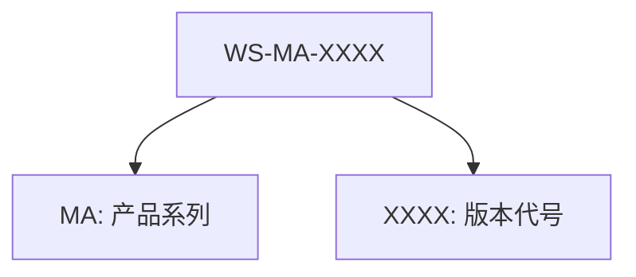

English | [中文](datasheet.md)
# Core Board Specification

> **Release Baseline**: EvoVerse SDK v0.8.0 · 2026-07-30

| Property | Value |
| --- | ---------- |
| Version | v0.0.1 |
| Date | 2026-04-22 |
| Status | Draft |

## 1. Product Overview

The WS core board is a flexible and versatile high-performance, low-power FPGA processing module. It natively integrates multiple MIPI D-PHY 2.5G transceiver ports, a USB 3.2 high-speed serial interface, and more, and can be flexibly configured via the FPGA to extend support for Ethernet, various sensor interfaces, industrial communication ports, and other interfaces. The WS core board is built on the Efinix Titanium™ series FPGA and is widely used across industrial fields such as video processing, data acquisition, robot control, and AI acceleration.

### 1.1 Version Description

The core board is offered in 4 variants, all built on the same core FPGA chip; the main difference lies in the USB controller configuration:

| Version | USB PHY Controller | Description |
| -------- | ------------ | ------------------------------- |
| MC-00-U00 | None | Basic variant, no USB interface, uses schematic revision B |
| MC-00-U05 | EZ-USB™ FX5 | USB 3.2 Gen1×1, low-cost option, uses schematic revision A |
| MC-00-U10 | EZ-USB™ FX10 | USB 3.2 Gen2×1, standard option, uses schematic revision A |
| MC-00-U20 | EZ-USB™ FX20 | USB 3.2 Gen2×2, maximum bandwidth, uses schematic revision A |

**Compatibility Note**: All core board variants share the same connector and PCB layout design and interconnect seamlessly with the same base board. Schematic revision A does not have connector P4.

### 1.2 Core Board Architecture

%%KEEP_LINE_30%%

## 2. Hardware Specifications

### 2.1 Key Devices

| Device | Part Number | Description |
| ---------- | ---------------------------------- | --- |
| FPGA | TJ180A484S | Efinix Titanium™ Ti180, 484-FBGA SiP package |
| USB PHY Controller | EZ-USB™ FX5/FX10/FX20 | Infineon EZ-USB™ series with USB3.2 support, differing by core board variant. MC-00-U00: not installed; MC-00-U05: up to 5Gbps USB transfer; MC-00-U10: up to 10Gbps USB transfer; MC-00-U20: up to 20Gbps USB transfer |
| Flash | W25Q256JWPIQ | Winbond Electronics, QSPI 256Mb, stores the FPGA boot image |
| Clock | U13:50MHz, U14:33.33MHz, U15:27MHz | U13 connects to FPGA pin T18 as the main logic reference clock; U14 connects to FPGA pin Y14 as the DDR reference clock; U15 outputs connect to FPGA pins AA10 and AA15 as the MIPI interface reference clocks |
| Security Chip | RJGT05T3 | Provides security protection for the FPGA boot image |

### 2.2 Main Connectors

| Connector | Part Number | Description |
| --- | ----------- | --- |
| P1 | DF40C-100DP | Provides 4 dedicated MIPI D-PHY 2.5Gbps 4-lane interfaces in total (2 TX + 2 RX; each group has 5 high-speed differential pairs: 1 clock + 4 data), plus 32 FPGA user IO pins |
| P2 | DF40C-120DP | USB PHY controller interface (including USB high-speed signals), plus 42 FPGA user IO pins |
| P3 | DF40C-120DP | 78 FPGA user IO pins, the 5V main power input of the core board, and the JTAG signals for FPGA configuration loading |
| P4 | (Reserved) | (Reserved) |
| P5 | DF40C-20DP | Integrates the JTAG programming port of the FPGA (and its internal soft-core CPU), the JTAG programming port of the EZ USB PHY controller, and the 5V core board power supply port (the board can be powered standalone when no base board is attached). Compact design; a dedicated adapter accessory is required to connect to the corresponding programmer |

> **User IO Breakout**: The FPGA breaks out a total of 73 HVIO pins and 124 HSIO (62 pairs) pins to the connectors.

### 2.3 Buttons/Switches

| Device | Description |
| -------------- | ----------------------------------- |
| FX\_RST(SW1) | USB PHY controller reset push-button switch |
| FPGA\_RST(SW2) | FPGA reset push-button switch |
| SW3 | 2-bit DIP switch, boot image selection (CBSEL) when the FPGA actively loads from flash |

### 2.4 Indicators

| Device | Description |
| --- | -------------------------- |
| D2 | Green LED, EZ USB PHY controller indicator |
| D3 | Green LED, FPGA configuration-done indicator (CDONE) |
| D4 | Green LED, user-controllable indicator, connected to FPGA pin AA11 |

## 3. Power Requirements

### 3.1 Power Specifications

| Parameter | Value | Description |
| ---------- | ------ | ------- |
| **Main supply voltage** | 5V DC | Core board operating voltage |
| **Theoretical maximum current** | < 3A | Peak current at full load |
| **Expected supply ripple** | ≤ 50mV | Power supply noise target |

### 3.2 Power Input Path

When the core board system is in operation, the power input path should go through **connector P3** and be powered from the base board system.

### 3.3 Standalone Power Connector (P5) ⭐

The design reserves connector **P5** for powering up and configuring the core board independently when it is not attached to a base board.

> ⚠️ **Safety Warning**: **Never connect P5 and P3 to other systems** (such as a base board or a programmer) at the same time. Connecting both simultaneously may cause power conflicts, circuit damage, or other unpredictable consequences.

## 4. Mechanical Specifications

As shown in the top view below, the physical planar dimensions of the core board are approximately **40mm × 45mm**. With all components installed, the height difference between the highest and lowest points of the core board is approximately 6mm. When designing your own system, treat 6mm as the minimum physical height difference and leave ample margin to avoid conflicts with other structures.

Because the WS product comes in multiple variants, please contact your sales or customer service representative to confirm the latest information on mechanical dimension specifications and avoid improper losses.

%%KEEP_LINE_98%%

## 5. Ordering Information

### 5.1 Product Model Naming Rule (Preliminary)

### 5.2 Standard Product List (Preliminary)

| Model | FPGA | USB PHY Controller | Description |
| ------------ | ---------- | ----------------- | ----------------- |
| WS-MA-00 | TJ180A484S | None | FPGA core board |
| WS-MA-05 | TJ180A484S | EZ-USB™ FX5 | Up to USB3.2 5Gbps |
| WS-MA-10 | TJ180A484S | EZ-USB™ FX10 | Up to USB3.2 10Gbps |
| WS-MA-20 | TJ180A484S | EZ-USB™ FX20 | Up to USB3.2 20Gbps |

### 5.3 Contact

For more product information or to request a quotation, please contact our sales team.

## Appendix A. Connector Pin Assignment Tables

!\[Connector P1 Pin Assignment Table] <!-- TODO: insert P1 pin assignment table -->

!\[Connector P2 Pin Assignment Table] <!-- TODO: insert P2 pin assignment table -->

!\[Connector P3 Pin Assignment Table] <!-- TODO: insert P3 pin assignment table -->

!\[Connector P4 Pin Assignment Table] <!-- TODO: insert P4 pin assignment table -->

!\[Connector P5 Pin Assignment Table] <!-- TODO: insert P5 pin assignment table -->
