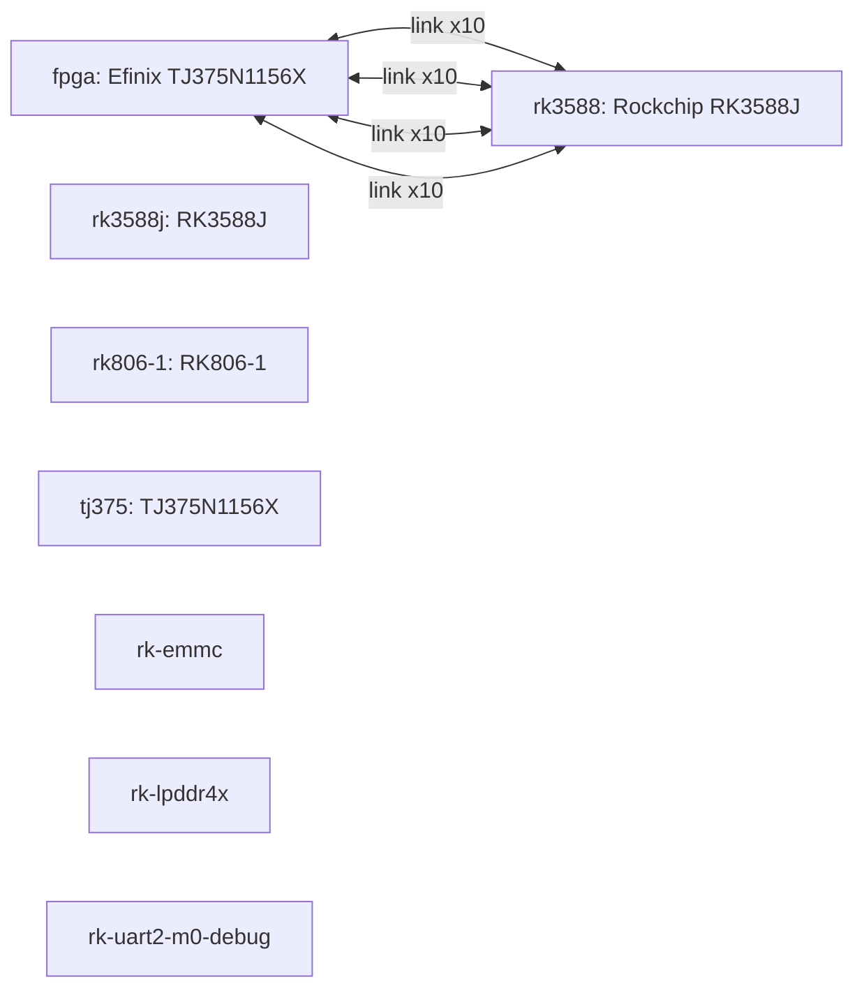

# WS-E2 Heterogeneous System-on-Module board manual

Revision `1` · material `1.0.0` · composition `module_carrier`.

This combined manual presents the resolved product while preserving module and carrier facts as separate machine-owned layers.

## Architecture

## Development targets

| Target | Type | Adapter | Exact device | State |
| --- | --- | --- | --- | --- |
| fpga | fpga | efinity | Efinix TJ375N1156X | CONFIRMED |
| rk3588 | soc | rk3588 | Rockchip RK3588J | CONFIRMED |

## Pin coverage

| Target | Coverage | Evidence |
| --- | --- | --- |
| fpga | FUNCTIONAL_PINOUT_ONLY | pinout/ws-e2-fpga-v1.csv |
| rk3588 | FUNCTIONAL_PINOUT_ONLY | pinout/ws-e2-rk3588j-v1.csv |

## Hardware

Facts below are rendered once from the resolved module/carrier layers. Intermediate board-to-board connector positions are intentionally excluded.

| ID | Category/Purpose | Manufacturer | Part | State | Sources |
| --- | --- | --- | --- | --- | --- |
| rk3588j | — | — | RK3588J | CONFIRMED | ws-e2-som-schematic |
| rk806-1 | — | — | RK806-1 | CONFIRMED | ws-e2-som-schematic |
| tj375 | — | — | TJ375N1156X | CONFIRMED | tj375-efinity-pinout, ws-e2-som-schematic |
| rk-emmc | — | — | — | CONFIRMED | ws-e2-som-schematic |
| rk-lpddr4x | — | — | — | UNVERIFIED | ws-e2-som-schematic |
| rk-uart2-m0-debug | — | — | — | CONFIRMED | ws-e2-som-schematic |
| rk-debug-console | — | — | — | CONFIRMED | ws-e2-som-schematic |
| rk-emmc-boot | — | — | — | CONFIRMED | ws-e2-som-schematic |

## Board interfaces

| ID | Protocol | Direction | Endpoints | State | Sources |
| --- | --- | --- | --- | --- | --- |

## Final cross-chip interface contract

| ID | Protocol | Direction | Final endpoints | Clock | Reset | State |
| --- | --- | --- | --- | --- | --- | --- |
| mipi0-tx | — | — | fpga (10) ↔ rk3588 (10) | — | — | CONFIRMED |
| mipi1-tx | — | — | fpga (10) ↔ rk3588 (10) | — | — | CONFIRMED |
| mipi2-tx | — | — | fpga (10) ↔ rk3588 (10) | — | — | CONFIRMED |
| rk-gpio-spi-iic | — | — | fpga (10) ↔ rk3588 (10) | — | — | CONFIRMED |

## Power

| ID | Voltage | Consumers | State | Sources |
| --- | --- | --- | --- | --- |
| rk-vcc-5v0-input | 5.0 | — | CONFIRMED | ws-e2-som-schematic |
| rk806-regulated-domains | — | — | CONFIRMED | ws-e2-som-schematic |

## Clocks

| ID | Frequency | Consumers | State | Sources |
| --- | --- | --- | --- | --- |
| rk-xin24m | 24000000 | — | CONFIRMED | ws-e2-som-schematic |

## Bring-up and development

### Bring-up

1. Review every `UNVERIFIED` or `CONFLICT` item before power-up.
2. Confirm rails, clock frequency, reset polarity, boot mode, and debug path from controlled sources.
3. Run the FPGA native unified compile; record compile evidence separately from programming and hardware evidence.
4. Bind the RK3588 profile to a real pinned BSP before any build claim.
5. Program, boot, and board-test only with their own evidence receipts.

### Development guide

| Target | Type | Adapter | Exact device | State |
| --- | --- | --- | --- | --- |
| fpga | fpga | efinity | Efinix TJ375N1156X | CONFIRMED |
| rk3588 | soc | rk3588 | Rockchip RK3588J | CONFIRMED |

- FPGA Stage0 is generated from confirmed `main_clock`, `reset`, and `user_led` facts. A generated project is not a native-build PASS.
- RK3588 remains `PROFILE_READY` until a real source root, pinned BSP commit, build environment, loader, partition layout, and artifacts are explicitly bound.
- Use the System project when both targets and their interface contract must be developed together.

## Uncertainty and conflicts

- `memories.rk-lpddr4x` — `UNVERIFIED`

## Evidence sources

| ID | Type | Owner | Location | Observed | State |
| --- | --- | --- | --- | --- | --- |
| rockchip-kernel-rk3588-6.1 | web_page | rockchip-linux | https://github.com/rockchip-linux/kernel/tree/develop-6.1/arch/arm64/boot/dts/rockchip | 2026-09-22 | CONFIRMED |
| rockchip-rkbin-rk3588 | web_page | rockchip-linux | https://github.com/rockchip-linux/rkbin/blob/master/doc/release/RK3588_EN.md | 2026-09-22 | CONFIRMED |
| tj375-efinity-pinout | tool_output | efinix | devices/TJ375N1156X.pinout.csv | 2026-09-22 | CONFIRMED |
| ws-e2-som-schematic | board_document | ws-e2-hardware | boards/ws-e2/ws-e2.md | 2026-09-22 | CONFIRMED |

Distributor and community pages are discovery-only and cannot confirm electrical or functional facts.
