English | [中文](rk3588j-evm.md)

# RK3588J EVM — TJ375 Baseboard (TJ375_RK3588J_EVM) Documentation

Efinix TJ375_RK3588J_EVM evaluation baseboard (schematic V01, 25 pages). It carries the
**WS-E2 core module** (TJ375 FPGA + RK3588) through a 1280-pin BTB connector and provides
dual gigabit Ethernet, EtherCAT, SDI, SFP, FMC, audio, USB, HDMI, M.2/PCIe and other
industrial and video interfaces. The core module is treated as a single module in this document.

## 1. System Topology Block Diagram (core module as a module)

```mermaid
flowchart TB
    subgraph SOM ["WS-E2 核心模组（经 BTB 1280 pin）"]
        direction LR
        FPGA["TJ375N1156X FPGA<br/>MIPI 3xTX/3xRX · QSE x4 SERDES x2<br/>GMAC · LPDDR4x 4GB · W66 NAND"]
        RK["RK3588J SoC<br/>8核 A76/A55 · NPU 6T<br/>GMAC x2 · PCIE3.0 x2 · USB3 x3"]
        PMIC["RK806-1 PMIC"]
        RK <-->|"PCIe 3.0 Q0 (2x2)<br/>RGMII x12 · CSI0/1 (MIPI)<br/>SPI/I2C/GPIO"| FPGA
        PMIC --> RK
        PMIC --> FPGA
    end

    subgraph EVM ["EVM 底板"]
        direction TB
        subgraph NET ["工业网络"]
            PHY1["RTL8211FI #1<br/>(RK GMAC1)"] --- RJ45A["RJ45 千兆 ×1<br/>HR913550AE"]
            PHY2["RTL8211FI #2<br/>(TJ RGMII0)"] --- RJ45B["RJ45 千兆 ×1"]
            ECAT["LAN9252<br/>EtherCAT 从站"]
            SFP["SFP 光口 ×2"]
        end
        subgraph VIDEO ["视频"]
            HDMIIN["HDMI2.0 IN<br/>(RK HDMI RX)"]
            HDMIOUT["HDMI TX ×2<br/>(RK HDMI0/1)"]
            CAM["MIPI 摄像头座<br/>(FPGA MIPI1/2_RX + MIPI2_TX)"]
            SDI["SDI ×2 通道<br/>TX/RX + BNC"]
            EDP["eDP/DP"]
        end
        subgraph EXP ["扩展"]
            FMC["FMC 连接器<br/>(FPGA LA/HA 对)"]
            M2["M.2 / PCIe 插槽<br/>(RK PCIE30_PORTx + PCIE20)"]
            TYPEC["USB3 TypeC ×2<br/>(RK USB3 OTG) + ESD73034"]
            USBH["USB2/3 HOST"]
        end
        subgraph MISC ["外设与调试"]
            AUDIO["ES8388 音频 codec<br/>+ 耳机/Line-in"]
            DBG["FT JTAG/UART 桥<br/>+ MAX3232 ×2 + CDCLVC1106"]
            SD["microSD"]
            KEY["按键 ×N + 拨码"]
        end
        subgraph PWR ["电源"]
            BUCK["TPS568230 (FPGA VCC_CORE)<br/>TPS562211 ×2 · TPS56528<br/>SI7137DP 12V 开关"]
        end
    end

    FPGA <-->|"TJ_PHY0 RGMII ×16"| PHY2
    FPGA <-->|"LAN9252 总线+差分 ×25"| ECAT
    FPGA <-->|"SDI 差分 ×12"| SDI
    FPGA <-->|"SFP 控制+差分 ×16"| SFP
    FPGA <-->|"MIPI HS ×60"| CAM
    FPGA <-->|"LA/HA 差分"| FMC
    FPGA <-->|"JTAG + UART"| DBG
    FPGA <---|"EVM 晶振 25M/100M ×6"| XO["Y0-Y5 晶振组"]
    RK <-->|"GMAC1 RGMII"| PHY1
    RK -->|HDMI| HDMIOUT
    RK -->|HDMI RX| HDMIIN
    RK <--> M2
    RK <--> TYPEC
    RK <--> AUDIO
    RK --- SD
    RK --- KEY
    BUCK -->|"VCC_5V0 / VCC_CORE"| SOM
```



## 2. Main Chips

| RefDes | Part | Function | Page |
|------|------|------|----|
| U61A/B etc. | BTB connector (1280 pin) | Core module interface | p15/p23/p24 |
| U68 | **RTL8211FI-CG** | RK GMAC1 gigabit PHY (RGMII→MDI) | p10 |
| U71 | **RTL8211FI-CG** | TJ (FPGA) second gigabit PHY (TJ_PHY0_RGMII0) | p19 |
| U72/U74 | **HR913550AE** | Gigabit RJ45 (integrated magnetics) ×2 | p19 |
| LAN9252 refdes | **LAN9252** | EtherCAT slave controller (16bit parallel bus + 2-port differential) | p19 |
| U23 | **ES8388** | Low-power audio codec (I2S + headphone/Line-in) | p6 |
| U16/U51 | **MAX3232IPWR** ×2 | RS232 (RK debug serial / TJ serial) | p4/p14 |
| U48 | FT series (ADBUS interface) | FPGA JTAG/UART bridge (USB) | p13 |
| U84/U87/U88 | **TPS562211DRLR** ×2 + **TPS56528DDAR** | Buck (5V/3V3 etc. intermediate rails) | p22 |
| U90 | **TPS568230RJER** | 18A buck (FPGA VCC_CORE 0.95V) | p22 |
| SI7137DP | Power MOSFET | 12V high-current switch (PCIe 12V) | p22 |
| U5x | **CDCLVC1106PWR** | Clock fanout (PCIe/debug clock distribution) | p13 |
| Y0-Y5 | Crystal group (25M/100M) + 22Ω series resistors | FPGA clock sources (CLK_25M_0/1/3, CLK_100M_0/1, CLK12) | p24 |
| ESD73034D | ESD array | TypeC protection | p9 |
| Q group | MMBT3904 / FDV301N / SI7137DP | Button/LED/power-switch transistors | p3/p8/p22 |
| D group | SKRPME010-style tact switches, B5819WS/SS54C (Schottky) | Buttons / power protection | various pages |
| LSF0102 | Level shifter | RK_VCC_QSE domain 1.8↔3.3V | p21 |

## 3. Interfaces and Connections (peer mapping)

### 3.1 RK3588 Side (via BTB; net names prefixed RK_)

| Interface | Signals | EVM devices |
|------|------|---------|
| Gigabit Ethernet #1 | RK_GMAC1_{MDC,MDIO,RSTn,RXCLK,RXD0-3,RXDV_CRS,TXCLK,TXD0-3,TXEN} ×16 | RTL8211FI(U68) + RJ45 |
| HDMI2.0 output ×2 | RK_HDMI{0,1}_TX D0-D2/CLK/HPD/CEC/SCL/SDA | HDMI connectors (p23-24) |
| HDMI2.0 input | RK_HDMI_RX D0-D3/CLK ×5 pairs | HDMI IN connector (p8) |
| USB3 OTG ×2 | TYPEC0/1 SSTX/SSRX ×2 pairs + CC | TypeC connectors + ESD73034 (p9) |
| PCIe slot | PCIE30 PORTx PERST/WAKE/CLKREQ + PCIE20 | M.2/slots (p11-12) |
| Debug serial | RK_UART2_TX/RX_M0_DEBUG | MAX3232(U16) + RS232 connector |
| Audio | RK_I2S0_{MCLK,SCLK,LRCK,SDI0} ×4 | ES8388 codec |
| microSD | RK_SDMMC0_{CMD,CLK,D0-3,DET} | Card slot (p5) |
| Buttons/LEDs | RK_USER_KEY/LED, RECOVERY, BOOT | Buttons/LEDs (p3) |

### 3.2 TJ375 (FPGA) Side (via BTB; net names prefixed TJ_, 164 nets)

| Interface | Signal count | EVM devices | Page |
|------|--------|---------|----|
| Second gigabit Ethernet | TJ_PHY0_{RGMII0_TXD0-3,RXD0-3,CLK,RXCK,TXEN,RXDV,ETH_MDC/MDIO/INT/RSTN} ×16 | RTL8211FI(U71)+RJ45 | p19 |
| EtherCAT | TJ_LAN9252_{D0-D15,CS,A1-A4,SYNC0/1,IRQ,TX/RX P/N A/B} ×25 | LAN9252 | p19 |
| SDI ×2 | TJ_SDI{0,1}_{TXP/N,RXP/N,SCL,SDA} ×12 | SDI equalizer/driver + BNC | p18 |
| SFP ×2 | TJ_SFP{0,1}_{TXP/N,RXP/N,SCL,SDA,MOD_ABS,TX_DISABLE} ×16 | SFP cages | p17 |
| MIPI cameras | TJ_HS_MIPI2_{RX,TX} + TJ_MIPI1_RX + TJ_MIPI2 ×60 | MIPI connectors | p23 |
| FMC | FMCA_LA/HA/CLK pairs (with clock compensation) | FMC connector | p20 |
| Serial ports ×3 + debug | TJ_UART{0,1,2}_{RX,TX} + TJ_FT_UART ×8 | MAX3232(U51)/FT | p14 |
| JTAG | TJ_{TCK,TMS,TDI,TDO,CRESET_N} + TJ_RSICV_* ×9 | FT JTAG bridge | p13 |
| Buttons/DIP switches | TJ_USER_KEY0-3 + TJ_USER_SW0/1 ×6 | Tact buttons | p3/p12 |
| Clock inputs | TJ_GPIOL_23/25/46/52 + TJ_GPIOR_95/97 ← Y0-Y5 crystals | 25M/100M crystals | p24 |
| QSE expansion | TJ_QSE{2,3,4}_GPIO ×15 | High-speed expansion reserve | p24 |

## 4. Power

12V DC input → SI7137DP switch → TPS562211×2 / TPS56528 (5V/3V3 rails) → BTB supplies VCC_5V0 to the
core module; TPS568230 (18A) generates FPGA VCC_CORE 0.95V; the PCIe slot has an independent VCC_12V0_PCIE.

## 5. Directory

```
rk3588j-evm/
├── rk3588j-evm.md           (this file)
├── pinout/rk3588j-evm.csv   baseboard pinout (BTB RefDes view, 1280 rows)
└── jackets/stage0/          Stage0 project (bank voltages + functional pinout + verification + Efinity project)
```

For the complete FPGA/RK ball-level mapping see `../ws-e2.md` sections 3/4 and `jackets/stage0/func-pinout-*.csv`.
