[English](rk3588j-evm.en.md) | 中文

# RK3588J EVM — TJ375 底板（TJ375_RK3588J_EVM）说明文档

易灵思 TJ375_RK3588J_EVM 评估底板（原理图 V01，25 页），经 1280-pin BTB 连接器承载
**WS-E2 核心模组**（TJ375 FPGA + RK3588），提供双千兆网口、EtherCAT、SDI、SFP、FMC、
音频、USB、HDMI、M.2/PCIe 等工业与视频接口。核心板在本文档中作为单一模块对待。

## 1. 系统拓扑框图（核心板为模块）

```mermaid
flowchart TB
    subgraph SOM ["WS-E2 核心模组（经 BTB 1280 pin）"]
        direction LR
        FPGA["TJ375N1156X FPGA<br/>MIPI 3xTX/3xRX · QSE x4 SERDES x2<br/>GMAC · LPDDR4x 4GB · W66 NAND"]
        RK["RK3588J SoC<br/>8核 A76/A55 · NPU 6T<br/>GMAC x2 · PCIE3.0 x2 · USB3 x3"]
        PMIC["RK806-1 PMIC"]
        RK <-->|"PCIe 3.0 Q0 (2x2)<br/>RGMII x12 · CSI0/1 (MIPI)<br/>SPI/I2C/GPIO"| FPGA
        PMIC --> RK
        PMIC --> FPGA
    end

    subgraph EVM ["EVM 底板"]
        direction TB
        subgraph NET ["工业网络"]
            PHY1["RTL8211FI #1<br/>(RK GMAC1)"] --- RJ45A["RJ45 千兆 ×1<br/>HR913550AE"]
            PHY2["RTL8211FI #2<br/>(TJ RGMII0)"] --- RJ45B["RJ45 千兆 ×1"]
            ECAT["LAN9252<br/>EtherCAT 从站"]
            SFP["SFP 光口 ×2"]
        end
        subgraph VIDEO ["视频"]
            HDMIIN["HDMI2.0 IN<br/>(RK HDMI RX)"]
            HDMIOUT["HDMI TX ×2<br/>(RK HDMI0/1)"]
            CAM["MIPI 摄像头座<br/>(FPGA MIPI1/2_RX + MIPI2_TX)"]
            SDI["SDI ×2 通道<br/>TX/RX + BNC"]
            EDP["eDP/DP"]
        end
        subgraph EXP ["扩展"]
            FMC["FMC 连接器<br/>(FPGA LA/HA 对)"]
            M2["M.2 / PCIe 插槽<br/>(RK PCIE30_PORTx + PCIE20)"]
            TYPEC["USB3 TypeC ×2<br/>(RK USB3 OTG) + ESD73034"]
            USBH["USB2/3 HOST"]
        end
        subgraph MISC ["外设与调试"]
            AUDIO["ES8388 音频 codec<br/>+ 耳机/Line-in"]
            DBG["FT JTAG/UART 桥<br/>+ MAX3232 ×2 + CDCLVC1106"]
            SD["microSD"]
            KEY["按键 ×N + 拨码"]
        end
        subgraph PWR ["电源"]
            BUCK["TPS568230 (FPGA VCC_CORE)<br/>TPS562211 ×2 · TPS56528<br/>SI7137DP 12V 开关"]
        end
    end

    FPGA <-->|"TJ_PHY0 RGMII ×16"| PHY2
    FPGA <-->|"LAN9252 总线+差分 ×25"| ECAT
    FPGA <-->|"SDI 差分 ×12"| SDI
    FPGA <-->|"SFP 控制+差分 ×16"| SFP
    FPGA <-->|"MIPI HS ×60"| CAM
    FPGA <-->|"LA/HA 差分"| FMC
    FPGA <-->|"JTAG + UART"| DBG
    FPGA <---|"EVM 晶振 25M/100M ×6"| XO["Y0-Y5 晶振组"]
    RK <-->|"GMAC1 RGMII"| PHY1
    RK -->|HDMI| HDMIOUT
    RK -->|HDMI RX| HDMIIN
    RK <--> M2
    RK <--> TYPEC
    RK <--> AUDIO
    RK --- SD
    RK --- KEY
    BUCK -->|"VCC_5V0 / VCC_CORE"| SOM
```



## 2. 主要芯片

| 位号 | 型号 | 功能 | 页 |
|------|------|------|----|
| U61A/B 等 | BTB 连接器（1280 pin） | 核心模组接口 | p15/p23/p24 |
| U68 | **RTL8211FI-CG** | RK GMAC1 千兆 PHY（RGMII→MDI） | p10 |
| U71 | **RTL8211FI-CG** | TJ（FPGA）第二千兆 PHY（TJ_PHY0_RGMII0） | p19 |
| U72/U74 | **HR913550AE** | 千兆 RJ45（内置变压器）×2 | p19 |
| LAN9252 位号 | **LAN9252** | EtherCAT 从站控制器（16bit 并行总线 + 2 端口差分） | p19 |
| U23 | **ES8388** | 低功耗音频 codec（I2S + 耳机/Line-in） | p6 |
| U16/U51 | **MAX3232IPWR** ×2 | RS232（RK 调试串口 / TJ 串口） | p4/p14 |
| U48 | FT 系列（ADBUS 接口） | FPGA JTAG/UART 桥（USB） | p13 |
| U84/U87/U88 | **TPS562211DRLR** ×2 + **TPS56528DDAR** | Buck（5V/3V3 等中间轨） | p22 |
| U90 | **TPS568230RJER** | 18A Buck（FPGA VCC_CORE 0.95V） | p22 |
| SI7137DP | Power MOSFET | 12V 大电流开关（PCIe 12V） | p22 |
| U5x | **CDCLVC1106PWR** | 时钟 fanout（PCIe/调试时钟分配） | p13 |
| Y0-Y5 | 晶振组（25M/100M）+ 22Ω 串阻 | FPGA 时钟源（CLK_25M_0/1/3、CLK_100M_0/1、CLK12） | p24 |
| ESD73034D | ESD 阵列 | TypeC 保护 | p9 |
| Q 组 | MMBT3904 / FDV301N / SI7137DP | 按键/LED/电源开关三极管 | p3/p8/p22 |
| D 组 | SKRPAME010（轻触）、B5819WS/SS54C（肖特基） | 按键 / 电源防护 | 各页 |
| LSF0102 | 电平转换 | RK_VCC_QSE 域 1.8↔3.3V | p21 |

## 3. 接口与连接（对端映射）

### 3.1 RK3588 侧（经 BTB，网名前缀 RK_）

| 接口 | 信号 | EVM 器件 |
|------|------|---------|
| 千兆网口 #1 | RK_GMAC1_{MDC,MDIO,RSTn,RXCLK,RXD0-3,RXDV_CRS,TXCLK,TXD0-3,TXEN} ×16 | RTL8211FI(U68) + RJ45 |
| HDMI2.0 输出 ×2 | RK_HDMI{0,1}_TX D0-D2/CLK/HPD/CEC/SCL/SDA | HDMI 座（p23-24） |
| HDMI2.0 输入 | RK_HDMI_RX D0-D3/CLK ×5 对 | HDMI IN 座（p8） |
| USB3 OTG ×2 | TYPEC0/1 SSTX/SSRX ×2 对 + CC | TypeC 座 + ESD73034（p9） |
| PCIe 插槽 | PCIE30 PORTx PERST/WAKE/CLKREQ + PCIE20 | M.2/插槽（p11-12） |
| 调试串口 | RK_UART2_TX/RX_M0_DEBUG | MAX3232(U16) + RS232 座 |
| 音频 | RK_I2S0_{MCLK,SCLK,LRCK,SDI0} ×4 | ES8388 codec |
| microSD | RK_SDMMC0_{CMD,CLK,D0-3,DET} | 卡座（p5） |
| 按键/LED | RK_USER_KEY/LED、RECOVERY、BOOT | 按键/LED（p3） |

### 3.2 TJ375（FPGA）侧（经 BTB，网名前缀 TJ_，164 网）

| 接口 | 信号数 | EVM 器件 | 页 |
|------|--------|---------|----|
| 第二千兆网口 | TJ_PHY0_{RGMII0_TXD0-3,RXD0-3,CLK,RXCK,TXEN,RXDV,ETH_MDC/MDIO/INT/RSTN} ×16 | RTL8211FI(U71)+RJ45 | p19 |
| EtherCAT | TJ_LAN9252_{D0-D15,CS,A1-A4,SYNC0/1,IRQ,TX/RX P/N A/B} ×25 | LAN9252 | p19 |
| SDI ×2 | TJ_SDI{0,1}_{TXP/N,RXP/N,SCL,SDA} ×12 | SDI 均衡/驱动 + BNC | p18 |
| SFP ×2 | TJ_SFP{0,1}_{TXP/N,RXP/N,SCL,SDA,MOD_ABS,TX_DISABLE} ×16 | SFP 笼座 | p17 |
| MIPI 摄像头 | TJ_HS_MIPI2_{RX,TX} + TJ_MIPI1_RX + TJ_MIPI2 ×60 | MIPI 座 | p23 |
| FMC | FMCA_LA/HA/CLK 对（含时钟补偿） | FMC 连接器 | p20 |
| 串口 ×3+调试 | TJ_UART{0,1,2}_{RX,TX} + TJ_FT_UART ×8 | MAX3232(U51)/FT | p14 |
| JTAG | TJ_{TCK,TMS,TDI,TDO,CRESET_N} + TJ_RSICV_* ×9 | FT JTAG 桥 | p13 |
| 按键/拨码 | TJ_USER_KEY0-3 + TJ_USER_SW0/1 ×6 | 轻触按键 | p3/p12 |
| 时钟输入 | TJ_GPIOL_23/25/46/52 + TJ_GPIOR_95/97 ← Y0-Y5 晶振 | 25M/100M 晶振 | p24 |
| QSE 扩展 | TJ_QSE{2,3,4}_GPIO ×15 | 高速扩展预留 | p24 |

## 4. 电源

12V DC 输入 → SI7137DP 开关 → TPS562211×2 / TPS56528（5V/3V3 轨）→ BTB 供核心板 VCC_5V0；
TPS568230（18A）生成 FPGA VCC_CORE 0.95V；PCIe 插槽独立 VCC_12V0_PCIE。

## 5. 目录

```
rk3588j-evm/
├── rk3588j-evm.md           (本文件)
├── pinout/rk3588j-evm.csv   底板 pinout（BTB 位号视角，1280 行）
└── jackets/stage0/          Stage0 工程（bank 电压 + 功能 pinout + 验证 + Efinity 工程）
```

FPGA/RK 完整球级映射见 `../ws-e2.md` 第 3/4 节与 `jackets/stage0/func-pinout-*.csv`。
