# WS-E2 Heterogeneous System-on-Module (SOM_NOR) board manual

Revision `1` · material `2.0.1` · composition `module_carrier`.

This combined manual presents the resolved product while preserving module and carrier facts as separate machine-owned layers.

## Architecture

```mermaid
flowchart LR
  n_fpga["fpga: Efinix TJ375N1156X"]
  n_rk3588["rk3588: Rockchip RK3588J"]
  n_bl24c512_eeprom["bl24c512-eeprom: BL24C512A-PARC"]
  n_cmt83085_rs485["cmt83085-rs485: CMT83085"]
  n_es8388_codec["es8388-codec: ES8388"]
  n_femdrw032g_emmc["femdrw032g-emmc: FEMDRW032G"]
  n_ft232_rk_debug["ft232-rk-debug: FT232RL"]
  n_ft4232_jtag_uart["ft4232-jtag-uart: FT4232HL-REEL"]
  n_ina226_power_mon["ina226-power-mon: INA226AIDGSR"]
  n_lan9252_ecat["lan9252-ecat: LAN9252I"]
  n_lmh1218_sdi["lmh1218-sdi: LMH1218RTWR"]
  n_lmh1219_sdi["lmh1219-sdi: LMH1219RTWR"]
  n_max3232_rs232_fpga["max3232-rs232-fpga: MAX3232IPWR"]
  n_max3232_rs232_rk["max3232-rs232-rk: MAX3232IPWR"]
  n_pi6c557_pcie_clk["pi6c557-pcie-clk: PI6C557-05BLE"]
  n_rk3588j["rk3588j: RK3588J"]
  n_rk806_1["rk806-1: RK806-1"]
  n_rtl8111hs_nic["rtl8111hs-nic: RTL8111HS"]
  n_rtl8211fi_ecat_phy["rtl8211fi-ecat-phy: RTL8211FI-CG"]
  n_rtl8211fi_rk_phy["rtl8211fi-rk-phy: RTL8211FI-CG"]
  n_tj375["tj375: TJ375N1156X"]
  n_tja1051_can0["tja1051-can0: TJA1051T/3/1J"]
  n_xl9555_carrier["xl9555-carrier: XL9555"]
  n_xl9555_module["xl9555-module: XL9555"]
  n_yt6801_nic["yt6801-nic: YT6801SH"]
  n_fpga_emmc_carrier["fpga-emmc-carrier"]
  n_fpga_lpddr4x["fpga-lpddr4x"]
  n_fpga_lpddr4x_dnp_note["fpga-lpddr4x-dnp-note"]
  n_fpga_qspi_nor["fpga-qspi-nor"]
  n_rk_emmc["rk-emmc"]
  n_rk_lpddr4x["rk-lpddr4x"]
  n_fpga_jtag_carrier["fpga-jtag-carrier"]
  n_fpga_jtag_ft4232["fpga-jtag-ft4232"]
  n_rk_debug_console_carrier["rk-debug-console-carrier"]
  n_rk_uart2_m0_debug["rk-uart2-m0-debug"]
  n_fpga <-->|"link x10"| n_rk3588
  n_fpga <-->|"link x10"| n_rk3588
  n_fpga <-->|"link x10"| n_rk3588
  n_fpga <-->|"link x10"| n_rk3588
```

## Development targets

| Target | Type | Adapter | Exact device | State |
| --- | --- | --- | --- | --- |
| fpga | fpga | efinity | Efinix TJ375N1156X | CONFIRMED |
| rk3588 | soc | rk3588 | Rockchip RK3588J | CONFIRMED |

## Pin coverage

| Target | Coverage | Evidence |
| --- | --- | --- |
| fpga | FUNCTIONAL_PINOUT_ONLY | pinout/ws-e2-fpga-v1.csv |
| rk3588 | FUNCTIONAL_PINOUT_ONLY | pinout/ws-e2-rk3588j-v1.csv |

## SoC development material

Per SoC development target: the selected official sources, generated files,
declared accelerator facts, the recorded environment requirement, and unresolved
optional peripherals. Environment installation, profile binding, and readiness
verdicts are owned by the Adapter (Environment Manager). Native build, image
packaging, boot, and hardware validation are separate evidence boundaries and
are not claimed here.

### rk3588

| Item | Value |
| --- | --- |
| Adapter | rk3588 |
| Device | Rockchip RK3588J |
| Official BSP source | rockchip-kernel-repo — rockchip-linux (https://github.com/rockchip-linux/kernel) CONFIRMED |
| Build environment source | UNRESOLVED — no authoritative first-party source selected |
| Host / toolchain | Linux Environment Manager provisioned host (WSL2 Ubuntu 24.04) · aarch64-linux-gnu- · 13.3.0 (Ubuntu 24.04 gcc-aarch64-linux-gnu; same version baked into evoverse/rk3588-ai-platform-builder@sha256:daa5f73b) |
| Device tree | platforms/rk3588/ws-e2-rk3588-mc.dts (expected DTB ws-e2-rk3588-mc.dtb) |
| Adapter profile template | platforms/rk3588/profile.template.json |
| Profile readiness | PROFILE_READY (unbound template); binding and readiness are owned by the Adapter |
| Environment requirement | `SATISFIED` |
| Requirement profile reference | platforms/rk3588/profile.template.json |
| Requirement capability | rk3588-cross-build |
| Requirement target architecture | aarch64 |
| Requirement compatibility scope | rockchip-linux vendor kernel/u-boot/rkbin cross build (CROSS_COMPILE=aarch64-linux-gnu-) |
| Qualification profile | recorded by the Adapter after qualification; left empty at generation |
| Unresolved optional peripherals | pcie3.0-x4 (PCIE30 lanes, CLK/RESET from corrected pinout), pcie2.0 (PCIE20 lanes with per-lane reset), typec0/typec1 (USB3 + DP mux-capable Type-C), usb2.0-host0/host1 and otg, hdmi-tx0/hdmi-tx1 and hdmi-rx, dp1, gmac0-gigabit-ethernet, sata, sdmmc0, headphone-audio, saradc/tsadc on-board sensors, recovery/boot key (BTB_EVM_KEY/BOOT) |
| BSP assembly (observed) | `CATALOG_DELIVERED` on 2026-11-11 |
| BSP root commit | `99a56fe7c7cf37db78aed56fff76a1a9572ee824` |
| BSP component kernel | `develop-6.1 @ 77168c8d5ab82399f65a80e9f807b50ba37cf483` |
| BSP component u-boot | `next-dev @ 1c535d65b8509f388d09e49fb6961f49fda35a1d` |
| BSP component buildroot | `2026.08.1 @ 7fdeadb3b9f12f78e5fccca914d7fef47090ab9a` |
| BSP component rkbin | `master @ 3e288fe814e059dd06833495f845cab04ac20a5c` |
| BSP SPL loader | `loaders/rk3588_spl_v1.14.bin (also rkbin/bin/rk35/ in-tree)` sha256 `b811b90b6847dc251838e82036c328f00eaacefe94659432265a0ccb0fc8f4e5` |
| Partition layout | `layouts/ws-e2-minimal-parameter.txt` sha256 `5a592e7227f0b211b7bd07e9532ccb69bafc913575e83772d515f97514c3616a` |
| Smoke evidence | 2026-11-11 on WSL Ubuntu-24.04, gcc-aarch64-linux-gnu 13.3.0 — compile-level smoke only; no flash, no boot, no hardware validation |
| Smoke kernel | `PASS` Image 41925120 bytes (release 6.1.172) + 77 rk3588 dtbs incl. rk3588-evb1-lp4-v10-linux.dtb |
| Smoke u-boot | `PASS` idbloader.img 343069 bytes (sha256 e17d4bfd88c14cd8582258776f5174f5cccc37437bf01db47ad665a89d0e4b17, in-tree TPL+SPL rksd) + u-boot.itb 2180096 bytes (sha256 3eaa94366716b468870d569e4228689545b10579da4845694537e2e759cdcb3d, FIT with BL31 v1.56 + BL32 v1.23); shas vary per build (embedded build timestamp) |
| Smoke buildroot | `PASS` full flashable set at WSL /root/ws-e2-bsp/.smoke-br-out/images/ws-e2-image/ - boot.img 42436608 bytes (sha256 24074cc1a9a26237ef82622d800b1a834f3ae867e0772c573d3af0613dd5b8b2, Android bootimg header v2, EVB dtb placeholder) + rootfs.ext4 536870912 bytes (sha256 7b5c44c45ddd94f4a8fc6d077f7bcfe00524e2baf4bca953128035f236dedafe) + idbloader/u-boot.itb/parameter.txt; mkbootimg vendored (Apache-2.0, apt mkbootimg broken - missing gki module) |

Environment installation and readiness are owned by the Adapter (Environment Manager); this Skill records requirements only; fetching and installing BSPs, toolchains, and container images is done by the Adapter, not by generation.
## Hardware

Facts below are rendered once from the resolved module/carrier layers. Intermediate board-to-board connector positions are intentionally excluded.

| ID | Category/Purpose | Manufacturer | Part | State | Sources |
| --- | --- | --- | --- | --- | --- |
| bl24c512-eeprom | — | — | BL24C512A-PARC | CONFIRMED | ws-e2-mc-carrier-schematic |
| cmt83085-rs485 | — | — | CMT83085 | CONFIRMED | ws-e2-mc-carrier-schematic |
| es8388-codec | — | — | ES8388 | CONFIRMED | ws-e2-mc-carrier-schematic |
| femdrw032g-emmc | — | — | FEMDRW032G | CONFIRMED | ws-e2-mc-carrier-schematic |
| ft232-rk-debug | — | — | FT232RL | CONFIRMED | ws-e2-mc-carrier-schematic |
| ft4232-jtag-uart | — | — | FT4232HL-REEL | CONFIRMED | ws-e2-mc-carrier-schematic |
| ina226-power-mon | — | — | INA226AIDGSR | CONFIRMED | ws-e2-mc-carrier-schematic |
| lan9252-ecat | — | — | LAN9252I | CONFIRMED | ws-e2-mc-carrier-schematic |
| lmh1218-sdi | — | — | LMH1218RTWR | CONFIRMED | ws-e2-mc-carrier-schematic |
| lmh1219-sdi | — | — | LMH1219RTWR | CONFIRMED | ws-e2-mc-carrier-schematic |
| max3232-rs232-fpga | — | — | MAX3232IPWR | CONFIRMED | ws-e2-mc-carrier-schematic |
| max3232-rs232-rk | — | — | MAX3232IPWR | CONFIRMED | ws-e2-mc-carrier-schematic |
| pi6c557-pcie-clk | — | — | PI6C557-05BLE | CONFIRMED | ws-e2-mc-carrier-schematic |
| rk3588j | — | — | RK3588J | CONFIRMED | ws-e2-som-nor-schematic |
| rk806-1 | — | — | RK806-1 | CONFIRMED | ws-e2-som-nor-schematic |
| rtl8111hs-nic | — | — | RTL8111HS | UNVERIFIED | ws-e2-mc-carrier-schematic |
| rtl8211fi-ecat-phy | — | — | RTL8211FI-CG | CONFIRMED | ws-e2-mc-carrier-schematic |
| rtl8211fi-rk-phy | — | — | RTL8211FI-CG | CONFIRMED | ws-e2-mc-carrier-schematic |
| tj375 | — | — | TJ375N1156X | CONFIRMED | tj375-efinity-pinout, ws-e2-som-nor-schematic |
| tja1051-can0 | — | — | TJA1051T/3/1J | CONFIRMED | ws-e2-mc-carrier-schematic |
| xl9555-carrier | — | — | XL9555 | CONFIRMED | ws-e2-mc-carrier-schematic |
| xl9555-module | — | — | XL9555 | CONFIRMED | ws-e2-som-nor-schematic |
| yt6801-nic | — | — | YT6801SH | CONFIRMED | ws-e2-mc-carrier-schematic |
| fpga-emmc-carrier | — | — | — | CONFIRMED | ws-e2-mc-carrier-schematic |
| fpga-lpddr4x | — | — | — | CONFIRMED | ws-e2-som-nor-schematic, ws-e2-catalog-material-v1 |
| fpga-lpddr4x-dnp-note | — | — | — | UNVERIFIED | ws-e2-som-nor-schematic, ws-e2-catalog-material-v1 |
| fpga-qspi-nor | — | — | — | CONFIRMED | ws-e2-som-nor-schematic |
| rk-emmc | — | — | — | CONFIRMED | ws-e2-som-nor-schematic |
| rk-lpddr4x | — | — | — | CONFIRMED | ws-e2-som-nor-schematic, ws-e2-catalog-material-v1 |
| fpga-jtag-carrier | — | — | — | CONFIRMED | ws-e2-mc-carrier-schematic |
| fpga-jtag-ft4232 | — | — | — | CONFIRMED | ws-e2-mc-carrier-schematic |
| rk-debug-console-carrier | — | — | — | CONFIRMED | ws-e2-mc-carrier-schematic |
| rk-uart2-m0-debug | — | — | — | CONFIRMED | ws-e2-mc-carrier-schematic |
| fpga-qspi-nor-config | — | — | — | CONFIRMED | ws-e2-som-nor-schematic |
| rk-debug-console | — | — | — | CONFIRMED | ws-e2-mc-carrier-schematic |
| rk-emmc-boot | — | — | — | CONFIRMED | ws-e2-som-nor-schematic |
| rk-maskrom-boot | — | — | — | CONFIRMED | ws-e2-mc-carrier-schematic |
| rk-maskrom-entry-carrier | — | — | — | CONFIRMED | ws-e2-mc-carrier-schematic |
| som-power-good | — | — | — | CONFIRMED | ws-e2-mc-carrier-schematic |

## Device behaviors

Electrical behavior derived from the schematic topology (pull-up/pull-down,
driver stage, common-terminal rail). Use these facts when writing RTL and
constraints for buttons, switches, LEDs, displays, and other user-facing
devices.

| ID | Device type | Component | Active level | Segment type | Derivation (from schematic) | State | Sources |
| --- | --- | --- | --- | --- | --- | --- | --- |
| btn-rk-maskrom | push_button | — | low | — | Carrier sheet 3 states RK_BOOT_SARADC_IN0=0V after power-on reset enters Maskrom mode and that SARADC_IN0 is internally pulled up to 1.8 V; the tact switch shorts the net to GND. | CONFIRMED | ws-e2-mc-carrier-schematic |
| dip-f-user-sw0-1 | dip_switch | — | UNVERIFIED | — | DSIC02LSGET 2-bit DIP drives F_USER_SW0/1 (carrier sheet 12); active level not derivable from extracted text. | UNVERIFIED | ws-e2-mc-carrier-schematic |
| dip-rk-user-sw0-3 | dip_switch | — | UNVERIFIED | — | DSIC04LSGET 4-bit DIP drives RK_USER_SW0-3 through carrier level shifters (sheets 3, 21); per-bit active level not derivable from extracted text. | UNVERIFIED | ws-e2-mc-carrier-schematic |
| fan-j1 | fan | — | UNVERIFIED | — | 3-pin fan connector J1 2510-3A driven by RK_PWM11_IR_M2_1V8 through MMBT3904 low-side stages (carrier sheet 3); PWM polarity not derivable from extracted text. | CONFIRMED | ws-e2-mc-carrier-schematic |
| led-f-user0 | led | — | UNVERIFIED | — | GREEN LED D79 with 22R series resistor on net F_USER_LED0 (carrier sheet 12); orientation not recoverable from extracted text. | UNVERIFIED | ws-e2-mc-carrier-schematic |
| led-f-user1 | led | — | UNVERIFIED | — | GREEN LED D81 with 22R series resistor on net F_USER_LED1 (carrier sheet 12); orientation not recoverable from extracted text. | UNVERIFIED | ws-e2-mc-carrier-schematic |
| led-rk-user0 | led | — | UNVERIFIED | — | GREEN LED D1 with 22R series resistor on net RK_USER_LED0 (carrier sheet 3); LED anode/cathode orientation not recoverable from extracted text. | UNVERIFIED | ws-e2-mc-carrier-schematic |
| led-rk-user1 | led | — | UNVERIFIED | — | GREEN LED D2 with 22R series resistor on net RK_USER_LED1 (carrier sheet 3); orientation not recoverable from extracted text. | UNVERIFIED | ws-e2-mc-carrier-schematic |

## Board interfaces

| ID | Protocol | Direction | Endpoints | State | Sources |
| --- | --- | --- | --- | --- | --- |
| fmc-a | — | — | — | CONFIRMED | ws-e2-mc-carrier-schematic |
| fpga-can | — | — | — | CONFIRMED | ws-e2-mc-carrier-schematic |
| fpga-ethercat | — | — | — | CONFIRMED | ws-e2-mc-carrier-schematic |
| fpga-jtag-usb | — | — | — | CONFIRMED | ws-e2-mc-carrier-schematic |
| fpga-rs485-rs232 | — | — | — | CONFIRMED | ws-e2-mc-carrier-schematic |
| fpga-sdi | — | — | — | CONFIRMED | ws-e2-mc-carrier-schematic |
| fpga-sfp-plus | — | — | — | CONFIRMED | ws-e2-mc-carrier-schematic |
| mipi-qse-connectors | — | — | — | CONFIRMED | ws-e2-mc-carrier-schematic |
| rk-audio | — | — | — | CONFIRMED | ws-e2-mc-carrier-schematic |
| rk-debug-usb | — | — | — | CONFIRMED | ws-e2-mc-carrier-schematic |
| rk-eth-rj45 | — | — | — | CONFIRMED | ws-e2-mc-carrier-schematic |
| rk-hdmi-tx-rx | — | — | — | CONFIRMED | ws-e2-mc-carrier-schematic |
| rk-pcie-gbe-nics | — | — | — | CONFIRMED | ws-e2-mc-carrier-schematic |
| rk-pcie-sata | — | — | — | CONFIRMED | ws-e2-mc-carrier-schematic |
| rk-sd-card | — | — | — | CONFIRMED | ws-e2-mc-carrier-schematic |
| rk-usb-host | — | — | — | CONFIRMED | ws-e2-mc-carrier-schematic |

## Final cross-chip interface contract

| ID | Protocol | Direction | Final endpoints | Clock | Reset | State |
| --- | --- | --- | --- | --- | --- | --- |
| mipi0-tx | — | — | fpga (10) ↔ rk3588 (10) | — | — | CONFIRMED |
| mipi1-tx | — | — | fpga (10) ↔ rk3588 (10) | — | — | CONFIRMED |
| mipi2-tx | — | — | fpga (10) ↔ rk3588 (10) | — | — | CONFIRMED |
| rk-gpio-spi-iic | — | — | fpga (10) ↔ rk3588 (10) | — | — | CONFIRMED |

## Power

| ID | Voltage | Consumers | State | Sources |
| --- | --- | --- | --- | --- |
| rk-vcc-5v0-som-input | 5.0 | — | CONFIRMED | ws-e2-mc-carrier-schematic, ws-e2-som-nor-schematic |
| rk806-regulated-domains | — | — | CONFIRMED | ws-e2-som-nor-schematic |
| vcc-12v-input | 12.0 | — | CONFIRMED | ws-e2-mc-carrier-schematic |
| vcc-5v0-con | 5.0 | — | CONFIRMED | ws-e2-mc-carrier-schematic |
| vcc-5v0-som | 5.0 | — | CONFIRMED | ws-e2-mc-carrier-schematic |
| vcc-3v3 | 3.3 | — | CONFIRMED | ws-e2-mc-carrier-schematic |
| vcc-2v5 | 2.5 | — | CONFIRMED | ws-e2-mc-carrier-schematic |
| vcc-1v8 | 1.8 | — | CONFIRMED | ws-e2-mc-carrier-schematic |
| vcc-1v2 | 1.2 | — | CONFIRMED | ws-e2-mc-carrier-schematic |
| fmc-vadj | 1.2 | — | CONFIRMED | ws-e2-mc-carrier-schematic |

## Clocks

| ID | Frequency | Consumers | State | Sources |
| --- | --- | --- | --- | --- |
| rk-xin24m | 24000000 | — | CONFIRMED | ws-e2-som-nor-schematic |
| som-clock-fanout-ez8304a | 25000000 | — | CONFIRMED | ws-e2-som-nor-schematic |
| pcie-refclk-pi6c557 | 100000000 | — | CONFIRMED | ws-e2-mc-carrier-schematic |
| sdi-clk-lmkdb1202 | UNVERIFIED | — | CONFIRMED | ws-e2-mc-carrier-schematic |

## Bring-up and development

### Bring-up

1. Review every `UNVERIFIED` or `CONFLICT` item before power-up.
2. Confirm rails, clock frequency, reset polarity, boot mode, and debug path from controlled sources.
3. Run the FPGA native unified compile; record compile evidence separately from programming and hardware evidence.
4. Bind the RK3588 profile to a real pinned BSP before any build claim.
5. Program, boot, and board-test only with their own evidence receipts.

### Development guide

| Target | Type | Adapter | Exact device | State |
| --- | --- | --- | --- | --- |
| fpga | fpga | efinity | Efinix TJ375N1156X | CONFIRMED |
| rk3588 | soc | rk3588 | Rockchip RK3588J | CONFIRMED |

- FPGA Stage0 is generated from confirmed `main_clock`, `reset`, and `user_led` facts. A generated project is not a native-build PASS.
- RK3588 remains `PROFILE_READY` until a real source root, pinned BSP commit, build environment, loader, partition layout, and artifacts are explicitly bound.
- Use the System project when both targets and their interface contract must be developed together.

## Uncertainty and conflicts

- `components.rtl8111hs-nic` — `UNVERIFIED`
- `memories.fpga-lpddr4x-dnp-note` — `UNVERIFIED`
- `device_behaviors.led-rk-user0` — `UNVERIFIED`
- `device_behaviors.led-rk-user1` — `UNVERIFIED`
- `device_behaviors.led-f-user0` — `UNVERIFIED`
- `device_behaviors.led-f-user1` — `UNVERIFIED`
- `device_behaviors.dip-rk-user-sw0-3` — `UNVERIFIED`
- `device_behaviors.dip-f-user-sw0-1` — `UNVERIFIED`

## Evidence sources

| ID | Type | Owner | Location | Observed | State |
| --- | --- | --- | --- | --- | --- |
| buildroot-upstream-repo | git_repository | buildroot | https://github.com/buildroot/buildroot | 2026-11-11 | CONFIRMED |
| rk3588j-device-authority | tool_output | evoverse-catalog | C:/Users/buton/evoverse-sdk/catalog/devices/RK3588J.authority.json | 2026-11-13 | CONFIRMED |
| rockchip-kernel-repo | git_repository | rockchip-linux | https://github.com/rockchip-linux/kernel | 2026-11-11 | CONFIRMED |
| rockchip-rkbin-repo | git_repository | rockchip-linux | https://github.com/rockchip-linux/rkbin | 2026-11-11 | CONFIRMED |
| rockchip-u-boot-repo | git_repository | rockchip-linux | https://github.com/rockchip-linux/u-boot | 2026-11-11 | CONFIRMED |
| tj375-efinity-pinout | tool_output | efinix | C:/Users/buton/evoverse-sdk/catalog/devices/TJ375N1156X.pinout.csv | 2026-11-13 | CONFIRMED |
| ws-e2-catalog-material-v1 | board_document | evoverse-catalog | C:/Users/buton/evoverse-sdk/catalog/boards/ws-e2 | 2026-11-13 | CONFIRMED |
| ws-e2-mc-carrier-schematic | board_document | elitestek | d:/work/evoverse-trae-generation-campaign/docs/WS-E2-RK3588-MC-V01_261102-1050.pdf | 2026-11-13 | CONFIRMED |
| ws-e2-som-nor-schematic | board_document | shennan-circuits | d:/work/evoverse-trae-generation-campaign/docs/TBS2009_SOM_NOR_20260917.pdf | 2026-11-13 | CONFIRMED |

Distributor and community pages are discovery-only and cannot confirm electrical or functional facts.
